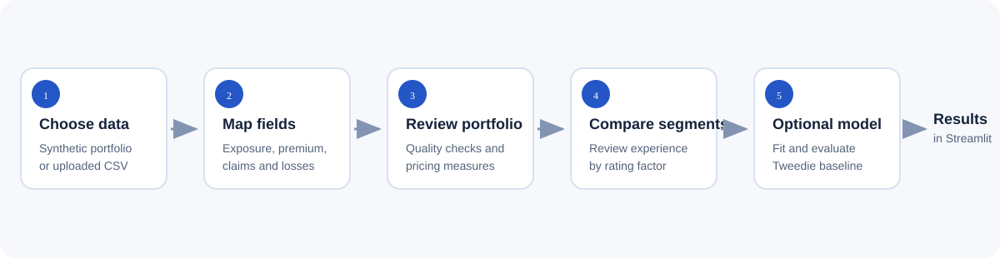
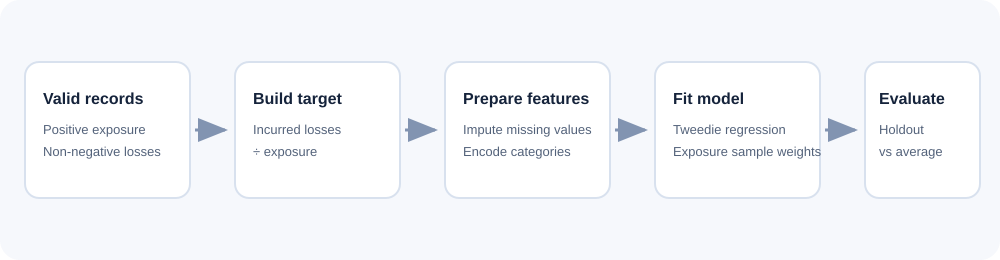

# PolicyLens: Insurance Pricing Analysis Agent

PolicyLens is a local Streamlit application for exploring policy-level insurance experience. It combines data checks, portfolio summaries, rating-factor comparisons, and an optional baseline machine-learning model.

> This is an exploratory portfolio project. It is not an actuarial rate indication or a production pricing system.



## Problem

Insurance data often arrives with different column names and needs basic quality review before analysts can compare experience. PolicyLens lets a user load a CSV, map key insurance fields, review common measures, and inspect experience across a selected rating factor.

## Features

- Reproducible, fictional demo portfolio (1,200 records, fixed random seed).
- Upload a policy-level CSV and map exposure, premium, claim-count, and incurred-loss fields.
- Portfolio summaries: exposure, loss ratio, claim frequency, claim severity, and pure premium when the needed fields are mapped.
- Initial data-quality warnings for missing or non-numeric values, negative values, invalid exposure, and losses paired with zero claims.
- Segment summaries for a selected categorical or numeric rating factor.
- Optional exposure-weighted Tweedie pure-premium model and holdout weighted MAE comparison with a portfolio-average baseline.
- Local Streamlit interface; this code does not call an LLM or external AI API.

## Technology

Python · Streamlit · pandas · NumPy · scikit-learn · unittest

## Architecture

The app is a small Python project. `app.py` owns the Streamlit interface, data selection and portfolio workflow. `modeling.py` contains the preprocessing and Tweedie baseline. Synthetic demo data is generated in `app.py`; the example CSV is a separate, fictional upload fixture.



See [BUILD_NOTES.md](BUILD_NOTES.md) for the detailed workflow, calculations, model setup, data handling, and limitations.

## Install

Requires Python 3.10 or newer.

### Windows (PowerShell)

```powershell
git clone https://github.com/SARIKA24KADAM/Insurance-pricing-agent.git
cd Insurance-pricing-agent
py -m venv .venv
.\.venv\Scripts\Activate.ps1
python -m pip install --upgrade pip
python -m pip install -r requirements.txt
streamlit run app.py
```

If script activation is blocked, call the environment executables directly:

```powershell
.\.venv\Scripts\python.exe -m pip install -r requirements.txt
.\.venv\Scripts\streamlit.exe run app.py
```

### macOS / Linux

```bash
git clone https://github.com/SARIKA24KADAM/Insurance-pricing-agent.git
cd Insurance-pricing-agent
python3 -m venv .venv
source .venv/bin/activate
python -m pip install --upgrade pip
python -m pip install -r requirements.txt
streamlit run app.py
```

Streamlit prints a local address, usually http://localhost:8501.

## Usage

1. Start the app and select **Synthetic demo portfolio** to explore the 1,200-row generated example, or select **Upload a CSV**.
2. For an upload, choose `sample-insurance-data.csv` or your own CSV. Each row should represent a policy or policy period.
3. In the sidebar, map earned exposure (required) and any available premium, claim-count, and incurred-loss fields.
4. Review the portfolio snapshot, metrics, data-quality notes, and one selected rating-factor comparison.
5. Optionally select model features and press **Fit baseline model**. At least 40 eligible records and some positive losses are required.

The sample CSV has 20 fictional records, so it demonstrates upload and portfolio summaries but is too small for model fitting. For an eligible model example, use the built-in synthetic portfolio.

### Example result from the included CSV

The 20-row sample totals 17.125 exposure years, $12,201.70 premium, 10 claims, and $36,915 in incurred losses. From these values the app reports approximately 302.5% loss ratio, 0.584 claims per exposure year, $3,691.50 severity, and $2,155.62 pure premium per exposure year. This small synthetic fixture is illustrative, not a pricing benchmark.

## Project structure

```text
Insurance-pricing-agent/
├── .github/
│   └── workflows/
│       └── tests.yml
├── docs/
│   ├── agent-workflow.svg
│   ├── model-pipeline.svg
│   └── sample-results.md
├── tests/
│   ├── test_sample_data.py
│   └── test_modeling.py
├── .env.example
├── .gitignore
├── app.py
├── BUILD_NOTES.md
├── modeling.py
├── README.md
├── requirements.txt
└── sample-insurance-data.csv
```

The two Python modules stay at the project root so the existing `streamlit run app.py` command and import remain unchanged.

## Tests

Run the model unit tests with the built-in unittest runner:

```bash
python -m unittest discover -s tests -v
```

The GitHub Actions workflow runs the same command for pushes and pull requests. These tests check model output shape and validation behavior; they do not validate actuarial suitability or replace app-level review.

## Security and privacy

- No API keys or external model credentials are required by the current implementation.
- `.env.example` documents that no environment variables are currently used; `.env` and Streamlit secrets are ignored by Git.
- The checked-in example CSV is fictional. Do not commit real policyholder data, credentials, or model artifacts.
- In a local run, uploaded data is processed in the app process. A hosted deployment would process uploads on its server; review its access controls before using confidential data.
- The app does not persist uploaded files to the project directory.

## Limitations

- This is a deterministic analysis workflow plus a statistical model, not a conversational or autonomous LLM agent.
- The model is a single train/holdout Tweedie baseline. A lower holdout error on one split is not evidence of stability or production readiness.
- The app does not handle policy limits, deductibles, coverage mix, trend, expenses, reinsurance, formal credibility, uncertainty, fairness review, or jurisdiction-specific pricing rules.
- Data checks are introductory and do not replace source-system reconciliation or actuarial validation.
- The segment support warning is a simple 20-record threshold, not a credibility standard.

## Roadmap

1. Add schema validation and clearer handling for missing and invalid numeric inputs.
2. Add repeatable model validation, calibration diagnostics, and uncertainty summaries.
3. Add downloadable analysis reports and richer segment controls.
4. Consider Excel/database input only with explicit data governance and privacy handling.
5. Add a natural-language interface only if it can be grounded in the computed results and validated safely.

## Portfolio presentation suggestions

- Suggested repository description: **Local Streamlit app for insurance portfolio analysis, data-quality review, rating-factor segmentation, and a Tweedie pure-premium baseline.**
- Suggested topics: `insurance-pricing`, `actuarial-science`, `data-science`, `machine-learning`, `streamlit`, `python`.
- Add a screenshot or short demo GIF of the running app after capturing it locally. No app screenshot is included yet.
- Keep the fictional sample and demo instructions prominent so recruiters can reproduce the experience safely.

## Publish or update with Git

To publish these prepared local files to the existing GitHub repository, first clone it and copy the prepared files into the clone. In PowerShell:

```powershell
git clone https://github.com/SARIKA24KADAM/Insurance-pricing-agent.git Insurance-pricing-agent-publish
$sourceDir = "D:\Projects\sarika-portfolio\insurance-pricing-agent"
Set-Location Insurance-pricing-agent-publish
Copy-Item "$sourceDir\*" . -Recurse -Force -Exclude ".git"
git status
```

Review the copied files, then run:

```bash
git status
git add README.md BUILD_NOTES.md .gitignore .env.example requirements.txt app.py modeling.py sample-insurance-data.csv docs tests .github
git diff --cached
git commit -m "Improve project documentation and tests"
git push origin main
```

For later changes, edit the files, then run:

```bash
git status
git add <changed-files>
git diff --cached
git commit -m "Describe the change"
git push origin main
```

Review `git diff --cached` before committing to ensure no real data, secrets, or local artifacts are staged.


